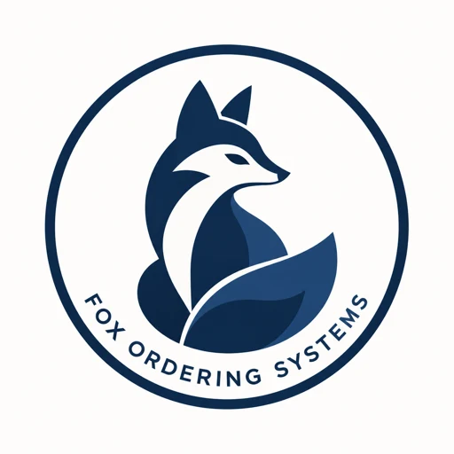
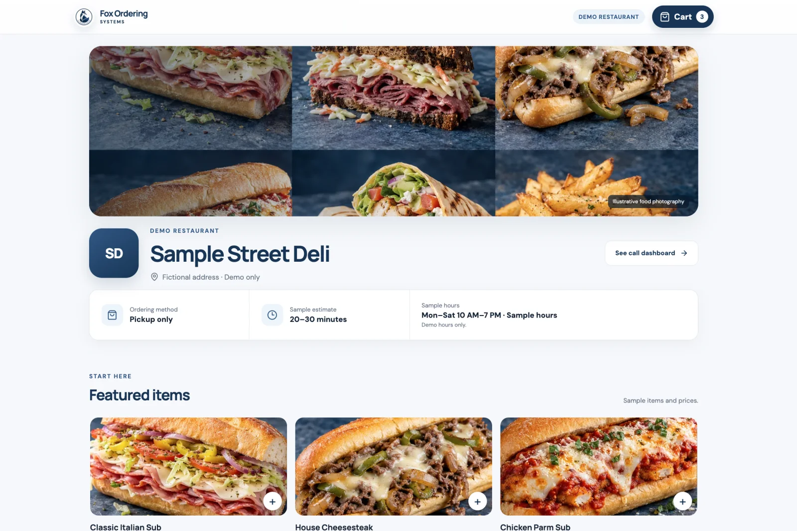

# Fox Ordering Systems

**A modern pickup-ordering experience connected to the way restaurants already operate.**

**Status:** Coming soon · [View Dylan's portfolio](https://dylanfox.work)

## The product

Fox Ordering Systems gives customers a clear mobile ordering flow, validates each pickup order, and delivers it to the restaurant through an automated phone workflow. The product is designed to reduce missed details without forcing a restaurant to rebuild its operation around new hardware.

## What I built

- A mobile-first menu, cart, checkout, and confirmation flow
- Structured customization and order validation
- Automated restaurant notification and acknowledgment workflows
- An operations view for order status and follow-up
- Guardrails for pilot testing and controlled rollout

I lead the product concept, operations design, full-stack implementation, and pilot planning.

## Repository note

This is a public product showcase. Production source code, telephony workflows, restaurant configuration, and infrastructure are maintained privately.

© 2026 Dylan Fox. All rights reserved.
